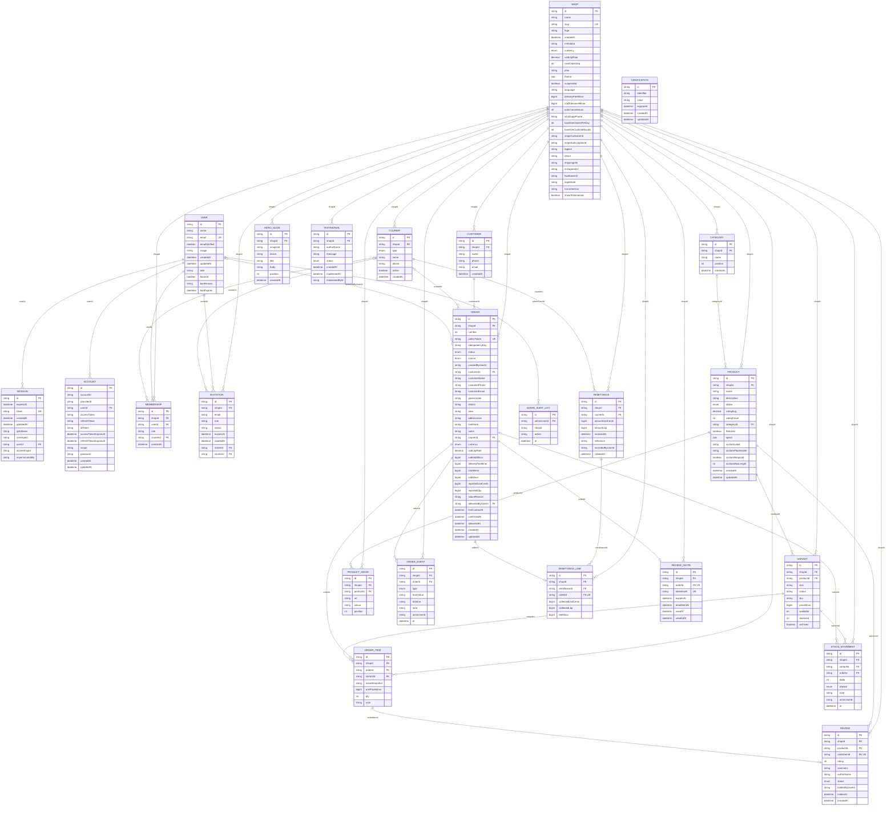

# Entity relationship diagram

Generated from `prisma/schema.prisma` by `npm run erd`. Do not edit by hand.

Every table except the Better Auth tables (`USER`, `SESSION`, `ACCOUNT`, `VERIFICATION`) and
`ADMIN_AUDIT_LOG` belongs to one shop through `shopId`. Money columns are `bigint`: US dollars in cents,
Lebanese pounds in whole pounds.

Rules the database enforces: unique `(shopId, number)` and `(shopId, idempotencyKey)` on orders,
unique `(productId, size, colour)` on variants, unique `orderId` on remittance lines and review invites,
unique `orderItemId` on reviews, and CHECK constraints keeping stock and prices at zero or above,
quantities above zero and ratings between 1 and 5.

