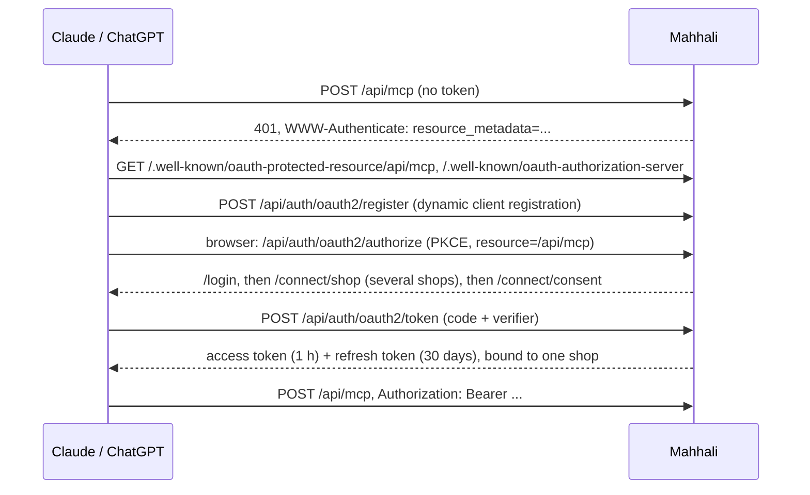

# AI assistants (MCP)

Shop members can use Mahhali from Claude or ChatGPT: ask about orders, stock, reviews, sales and cash
on delivery, and add products from a CSV file or by describing them, in English or Arabic, typed or
spoken in the assistant's app. Requirements: FR-34 to FR-39 and NFR-13 in [FR-NFR.md](FR-NFR.md).

## Connecting

1. In Claude (Settings → Connectors → Add custom connector) or ChatGPT (developer mode → connectors),
   add `https://<app>/api/mcp`.
2. The assistant registers itself and opens Mahhali's sign-in page. Sign in with your Mahhali account.
3. Members of several shops pick one shop. One connection works with one shop.
4. The consent page shows the app, the shop, your role and the permissions it asks for. Untick any you
   do not want to give, then Allow.

Disconnect from **Dashboard → Connected apps** (`/dashboard/connections`). Every member sees and
disconnects their own; the owner sees and disconnects everyone's, or all at once.

## How it works



- **Mahhali is the OAuth server** (`@better-auth/oauth-provider`, configured in
  `src/server/auth/auth.ts` and `oauth.ts`). Users never sign in with a Claude or ChatGPT account.
- **One shop per connection.** The shop picker stores the choice on the session (`connectShopId`, not
  the dashboard's active shop); the plugin saves it as `referenceId` on the consent and the tokens.
- **Opaque tokens, stored as SHA-256**, looked up on every call by `resolveMcpActor`
  (`src/server/http/session.ts`): not revoked or expired, issued for `/api/mcp`, app not disabled,
  user not banned, member of the token's shop, shop not suspended. It returns the same `Actor` the
  dashboard uses, plus the granted scopes.
- **Only these plugin endpoints are reachable over HTTP:** authorize, token, register, revoke,
  continue, consent. Client and consent management, introspection and userinfo stay closed.
- **`/api/mcp` is stateless Streamable HTTP** (`src/server/mcp/server.ts`). Each request builds a
  server with only the tools this connection may use. GET and DELETE answer 405.

## Permissions

A tool runs only if the member's role allows its action in `src/server/domain/policy.ts` **and** the
connection was granted its scope (`src/server/domain/mcpPolicy.ts`). The consent page and the
`/oauth2/consent` hook never grant a scope the role cannot use.

| Tool | Action | Scope | Owner | Manager | Staff | Delivery |
| --- | --- | --- | --- | --- | --- | --- |
| `shop_info` | any member | none | Yes | Yes | Yes | Yes |
| `list_orders`, `get_order` | `order.read` | `orders:read` | Yes | Yes | Yes | No |
| `my_deliveries` | `order.readAssigned` | `orders:read` | Yes | Yes | Yes | Own orders only |
| `list_products`, `stock_levels` | `product.read` | `catalogue:read` | Yes | Yes | Yes | No |
| `list_reviews` | `review.read` | `catalogue:read` | Yes | Yes | Yes | No |
| `sales_metrics` | `metrics.read` | `finance:read` | Yes | Yes | No | No |
| `cod_reconciliation`, `unsettled_cash` | `reconciliation.read` | `finance:read` | Yes | Yes | No | No |
| `preview_product_import`, `confirm_product_import`, `undo_product_import`, `photo_upload_link` | `product.write` | `catalogue:write` | Yes | Yes | No | No |

**Masking** (`src/server/domain/mask.ts`, applied in `assistantService`): customers appear as
"Maya H.", phones as `+961 7•••••56`, addresses down to the area, no emails; phone numbers and emails
inside order notes, failure reasons and reviews become `[phone hidden]` / `[email hidden]`.

## Adding products

1. `preview_product_import` takes up to 100 products (the assistant splits bigger files). Each row is
   checked with the dashboard's product schema, priced in the shop's currency, and flagged as a
   duplicate (same name, Arabic-normalised, or SKU) or an error. Nothing is created; the preview is
   saved for 15 minutes and a newer preview from the same member replaces it.
2. The assistant shows the preview; the user confirms or asks for changes (a new preview).
3. `confirm_product_import` creates everything in one transaction, live at once, after checking the
   shop again. Only the member who previewed it can confirm; confirming twice creates nothing more.
4. `undo_product_import` archives exactly that import's products within 24 hours.

Recommended CSV columns, one row per variant:
`name, description, category, option1, value1, option2, value2, sku, price, stock`.
Assistants also map other headers, Arabic included.

## Product photos

Assistants can't hand image files to a tool, so photos come in two ways. A product has at most 5
photos from both together; these routes only add photos (removing them stays in the dashboard).

**Photo links.** An `images` CSV column with links separated by `|`, or links typed in the chat, go
in each product's `images` (`{ url, colour? }`). `preview_product_import` downloads them straight
away so the preview can say which links failed; a failed link doesn't stop the product. Confirm
attaches them in order, with the colour as the photo's option value. Google Drive and Dropbox share
links are turned into direct downloads; Instagram links are refused with a pointer to the upload page.
The downloader (`src/server/storage/fetchPhoto.ts`) accepts HTTPS on port 443 only, without a user
name; it looks the host up, refuses private, loopback, link-local and reserved addresses (IPv4 and
IPv6), connects to the address it checked, checks every redirect again (3 at most), and stops at
10 seconds or 3 MB. The bytes must be PNG, JPEG or WebP. Up to 50 downloads per preview; files of
previews that are replaced or expire are deleted.

**Add photos page.** `confirm_product_import` returns a link `/p/<token>` (and `photo_upload_link`
makes a new one, which replaces the old). It works for 24 hours without signing in, only for that
import's products, and stops when the import is undone or the shop is suspended. On the page (mobile,
English and Arabic) the user picks several photos or takes one with the camera, optionally chooses a
colour, and the photos show in the dashboard right away. Photos are shrunk in the browser to fit 3 MB.
Uploads are all-or-nothing per request and rate limited per link and per address; only the token's
hash is stored.

Example CSV with photos:

```
name,option1,value1,price,stock,images
Linen shirt,Colour,White,25,10,https://example.com/white.jpg|https://example.com/white-back.jpg
Linen shirt,Colour,Navy,25,8,https://example.com/navy.jpg
```

## Safety

The server never sees the user's words, only tool calls. Whatever the assistant is told, a call can
only do what the role and scopes allow: the shop and role come from the token, tool inputs are strict
(an unknown field such as `shopId` is refused), there are no delete or free-form tools, imports only
create and need a preview first, and customer data is masked before it leaves the server. The server's
instructions tell the assistant that text written by customers is data, never instructions.

Every tool call is written to `mcp_tool_call` (outcome OK, ERROR, DENIED or INVALID, with duration),
never its input or output. Calls are rate limited to 120 a minute per connection.

## Tables

| Table | Purpose |
| --- | --- |
| `oauth_client`, `oauth_resource`, `oauth_client_resource`, `oauth_access_token`, `oauth_refresh_token`, `oauth_consent`, `oauth_client_assertion` | The OAuth plugin's tables; `referenceId` holds the shop |
| `product_import` | Previews, confirmed and undone imports (with downloaded photo links) |
| `import_photo_link` | The no-login "Add photos" link of a confirmed import (token hash, expiry) |
| `mcp_tool_call` | Audit log of tool calls |
| `product.importId` | The import that created a product |
| `session.connectShopId` | The shop picked while connecting |

## Tests

- Unit: `mask`, `arabic`, `mcp-policy` (role × scope, shop choice, consent narrowing), `product-import`,
  `photo-links` (HTTPS, share links, private addresses however written), `photo-resize`.
- Integration: `oauth-discovery`, `oauth-connect` (full OAuth flow with PKCE), `mcp-actor`,
  `mcp-endpoint`, `mcp-orders`, `mcp-catalogue`, `mcp-finance`, `mcp-import-preview`,
  `mcp-import-confirm`, `mcp-import-cleanup`, `mcp-connections`, `photo-fetch` (the downloader
  against a local HTTPS server: redirects, size, timeouts, private addresses), `mcp-import-photos`,
  `mcp-photo-links` (the upload page API), and `mcp-policy-matrix`, which calls
  every tool as every role and scans every read tool's output for customer phone numbers, names,
  emails and streets.
